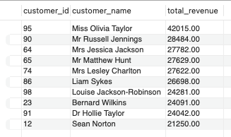
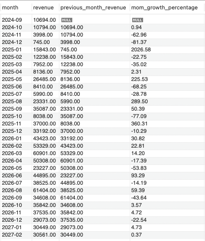
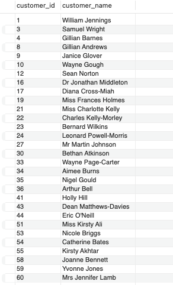
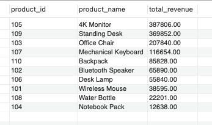
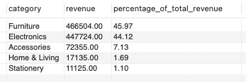
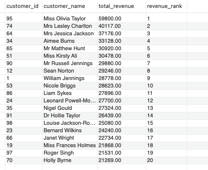
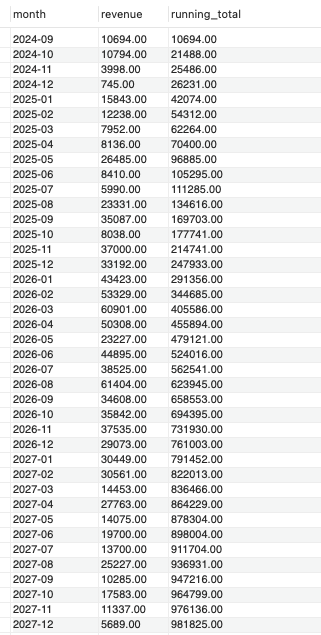
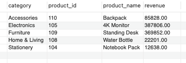
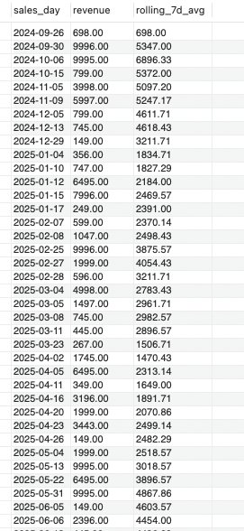

# Sales Revenue Analysis with SQL 💰

## Overview

This project uses MySQL and SQL to analyse sales performance, customer purchasing behaviour, and product revenue. It applies intermediate and advanced SQL techniques to extract business insights from customer, order, and product data.

## Tools and technologies

- **Database:** MySQL
- **SQL editor:** MySQL Workbench
- **Language:** SQL
- **Techniques:** Joins, aggregate functions, CTEs, subqueries, date functions, and window functions.

## Dataset

The project uses three datasets:

- `customers.csv`: Customer information.
- `orders.csv`: Order details, including products, quantities, prices, order dates, and payment statuses.
- `products.csv`: Product information, including product names and categories.

The datasets are stored in the `data/` directory. The database setup script, `sql/database_setup.sql`, creates the database and tables and loads the data for analysis.

## Intermediate SQL analysis

### 1. Top 10 customers by revenue

Identifies the ten customers generating the highest revenue from paid orders.



### 2. Month over month sales growth

Compares monthly revenue to analyse changes in sales performance over time.



### 3. Customers with consecutive monthly orders

Identifies customers who placed orders in consecutive months.



### 4. Products with highest revenue

Identifies the products generating the highest revenue.



### 5. Revenue contribution by category

Calculates the percentage of total revenue contributed by each product category.



## Advanced SQL analysis

### 1. Customer revenue ranking

Ranks customers according to their total revenue using window functions.



### 2. Monthly running total sales

Calculates cumulative monthly revenue to track overall sales progression.



### 3. Highest selling product per category

Identifies the highest revenue generating product within each category.



### 4. Seven day rolling average sales

Calculates a rolling average of daily sales to help identify short term trends.



## SQL concepts applied

- **Joins:** Combine customer, order, and product data.
- **Aggregate functions:** Calculate revenue and sales metrics.
- **CTEs and subqueries:** Organise multi step queries.
- **Date functions:** Group and compare sales over time.
- **Window functions:** Rank customers, calculate running totals, and compute rolling averages.
- **Filtering and grouping:** Analyse relevant transactions and summarise results.

## Repository structure

```text
sales-revenue-analysis-sql/
├── data/
├── screenshots/
│   ├── 01_rank_customers_by_revenue.png
│   ├── 01_top_10_customers_by_revenue.png
│   ├── 02_month_over_month_sales_growth.png
│   ├── 02_monthly_running_total_sales.png
│   ├── 03_customers_with_consecutive_month_orders.png
│   ├── 03_highest_selling_product_per_category.png
│   ├── 04_products_with_highest_revenue.png
│   ├── 04_seven_day_rolling_average_sales.png
│   └── 05_revenue_contribution_by_category.png
├── sql/
│   ├── advanced/
│   ├── intermediate/
│   └── database_setup.sql
├── .gitattributes
├── .gitignore
└── README.md
```
